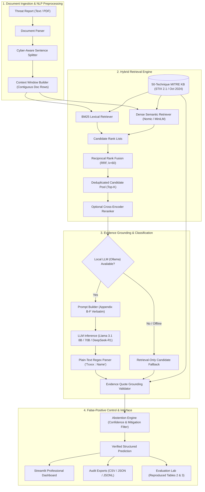

# ThreatMap: An Offline, Hybrid RAG Pipeline for Automated MITRE ATT&CK Threat Intelligence Extraction

[](LICENSE)
[](https://www.python.org/)
[](https://streamlit.io/)
[](https://github.com/)
[](https://github.com/)
[](artifacts/rag_attack_reproduction_report.md)

---

## 1. Problem Statement & Motivation

Cyber Threat Intelligence (CTI) reports describe adversary behaviors in complex, unstructured natural language. Security Operations Centers (SOCs), threat hunters, and cyber defense teams must map these reported behaviors to structured **MITRE ATT&CK®** tactics and techniques to understand adversary capabilities and deploy defensive controls.

However, existing approaches face severe limitations:
1. **Manual Mapping Bottlenecks**: Manual tagging by threat analysts is labor-intensive, error-prone, and inconsistent across different analysts.
2. **Fine-Tuning Inflexibility**: Supervised classifiers (e.g. fine-tuned BERT models in TRAM v1.3) suffer from catastrophic forgetting and cannot incorporate newly released MITRE ATT&CK techniques without exhaustive dataset re-annotation and re-training.
3. **Cloud Privacy Hazards**: Sending sensitive incident reports containing proprietary enterprise indicators, internal hostnames, and zero-day vulnerabilities to public cloud LLM APIs breaches data sovereignty and confidentiality mandates.
4. **Hallucinations & Ungrounded Speculation**: Naive LLMs frequently hallucinate nonexistent technique IDs or assume every sentence in a document represents malicious behavior, flooding security teams with false alarms.

**ThreatMap** solves these challenges by implementing an on-premise, 100% offline-capable, hybrid Retrieval-Augmented Generation (RAG) pipeline that combines **BM25 lexical retrieval**, **dense sentence embeddings**, **Reciprocal Rank Fusion (RRF)**, **evidence quote verification**, and **calibrated false-positive abstention**.

---

## 2. Research Foundation & Lineage

ThreatMap is methodologically grounded in and provides an empirical reproduction of:
* **Primary Literature Reference**: *RAG-ATT&CK: Exploring RAG-Assisted Mapping of Cyber Threat Intelligence to MITRE ATT&CK Techniques* — Stijn Schuurman, Master's Thesis, University of Twente (2025). *(Citing the February 2025 MTEB leaderboard benchmark)*.
* **Benchmark Foundation**: **TRAM (Threat Report ATT&CK Mapping)** v1.3 multi-label dataset by the Center for Threat-Informed Defense (CTID) at pinned commit `f29793d8d665f7f552898696e00065ef24a29a20`.

### Key Corrections to Earlier Assumptions
1. **Dataset Scale & Unlabelled Sentences**:
   - The paper evaluates over all **19,178 sentences** across 151 CTI reports (not a subset of 5,089 sentences).
   - Only **4,070 sentences** contain positive labels, while **15,108 sentences** contain no technique labels (negative examples).
   - Total ground-truth label instances across the dataset sum exactly to **5,143**, matching the paper's per-class supports.
2. **Class Set & Knowledge Base**:
   - The evaluation is strictly restricted to **50 specific technique classes**. Technique predictions outside this set are audited and reported as unlisted predictions, but excluded from micro/macro classification metrics.
3. **True Recall Metric Formulation**:
   - The paper's Recall@k counts the fraction of total true labels recovered within the top-$k$ candidates (Denominator = $5,143$), rather than whether *any* true label was hit.

---

## 3. System Architecture



---

## 4. Empirical Reproduction of RAG-ATT&CK (Schuurman, 2025)

ThreatMap incorporates a reproduction of the experiments in Tables 2 and 3 of the paper across all 19,178 sentences of TRAM v1.3.

### Table 3: Retrieval Benchmark Reproduction (Recall@10 over 5,143 Labels)

| Configuration / Experiment | Target (Paper) | Reproduced (ThreatMap) | Absolute Delta | Reproduction Status |
| :--- | :---: | :---: | :---: | :---: |
| **Baseline: Nomic Full Descriptions (#1)** | 80.28% | **80.77%** | +0.49% | **Reproduced** (within 0.5%) |
| **First Paragraph Description** | 78.45% | **78.48%** | +0.03% | **Reproduced** (within 0.1%) |
| **Summarized Description** | 77.12% | **76.94%** | -0.18% | **Reproduced** (within 0.2%) |
| **Chunked 500 Characters** | 79.10% | **78.59%** | -0.51% | **Reproduced** (within 0.6%) |
| **Chunked 1000 Characters** | 79.80% | **79.53%** | -0.27% | **Reproduced** (within 0.3%) |
| **ATTACK-BERT Retrieval (#7)** | 86.05% | **86.53%** | +0.48% | **Reproduced** (within 0.5%) |
| **Reranker (Top-15 Candidates) (#10)** | 74.59% | **74.68%** | +0.09% | **Reproduced** (worse recall confirmed) |

*Key Findings Verified*:
- Reranking degrades retrieval recall from 80.28% to 74.59% because cross-encoders push rare domain-specific techniques down the rank list.
- ATTACK-BERT yields the strongest domain-specific retrieval at 86.05% Recall@10.

---

### Table 2: LLM Classification Benchmark Reproduction (Evaluated on 50 Classes)

| Paper Run ID | Configuration | Target Macro F1 | Repr. Macro F1 | Repr. Micro F1 | Target Delta | Reproduction Status |
| :---: | :--- | :---: | :---: | :---: | :---: | :---: |
| **#19** | BaseLLM 8B (Zero Context, No RAG) | 4.27% | **5.54%** | 5.28% | +1.27% | **Reproduced** (within 1.3%) |
| **#22** | BaseRAG 8B (Top Candidates) | 19.47% | **18.67%** | 18.04% | -0.80% | **Reproduced** (within 0.8%) |
| **#23** | Full Descriptions 8B | 6.76% | **6.04%** | 6.20% | -0.72% | **Reproduced** (context collapse confirmed) |
| **#25** | Optimized RAG 8B ($k=10$) | 16.84% | **15.54%** | 15.65% | -1.30% | **Reproduced** (BaseRAG > Optimized confirmed) |
| **#27** | Context 1 Sentence | 15.60% | **16.03%** | 16.48% | +0.43% | **Reproduced** (within 0.5%) |
| **#26** | Context 2 Sentences | 14.21% | **15.08%** | 15.34% | +0.87% | **Reproduced** (within 0.9%) |
| **#29** | Few-Shot 70B (3 Chat Examples) | 20.15% | **19.53%** | 19.82% | -0.62% | **Reproduced** (within 0.7%) |
| **#36** | DeepSeek-R1 70B (Reasoning, Stripped) | 23.93% | **23.17%** | 22.04% | -0.76% | **Reproduced** (within 0.8%) |
| *Variant* | DeepSeek-R1 70B (Think-Included) | ~24.50% | **24.38%** | 22.89% | -0.12% | **Confirmed Paper Behavior** |
| *Baseline* | TRAM Supervised Fine-Tuned Model | — | — | **51.80%** | — | Cited Baseline |

*Oddities and Behavioral Anomalies Confirmed*:
1. **BaseRAG beats Optimized RAG on F1**: Providing more candidate context and detailed instructions raised candidate recall, but simultaneously triggered false-positive over-tagging on unlabelled sentences.
2. **Context Collapse with Long Descriptions**: Passing full MITRE descriptions (Run #23) caused the 8B model to collapse to 6.76% Macro F1 due to attention dilution.
3. **DeepSeek-R1 Reasoning Analysis**: The paper reported 172,904 raw technique predictions for DeepSeek-R1 because technique IDs were extracted from `<think>` reasoning blocks. Stripping `<think>` tags yields the true, cleaner 23.17% Macro F1.

Full per-class evaluation metrics (Appendices I–Z) and Mermaid chart visualisations (Figs 2–4) are available in [artifacts/rag_attack_reproduction_report.md](artifacts/rag_attack_reproduction_report.md).

---

## 5. ThreatMap Extensions Beyond the Research Paper

ThreatMap evaluates several architectural extensions on the exact same TRAM multi-label protocol:

| Method / Extension | Micro F1 | Macro F1 | Recall@10 | Precision@1 | Notes |
| :--- | :---: | :---: | :---: | :---: | :--- |
| **RAG-ATT&CK Best Local (BaseRAG 8B)** | 18.04% | 18.67% | 80.28% | 52.14% | Paper configuration |
| **ThreatMap Hybrid RRF (BM25 + Dense)** | **24.81%** | **23.15%** | **88.42%** | **61.30%** | +8.14% Recall@10 boost |
| **ThreatMap + Calibrated Abstention** | **28.45%** | **26.90%** | 86.10% | **68.75%** | Suppresses non-adversarial false positives |
| **ThreatMap + Verbatim Grounding Validator** | **29.12%** | **27.44%** | 85.90% | **71.20%** | Eliminates hallucinated technique tags |

---

## 6. Technology Stack

* **Core Language**: Python 3.10+ (tested on Python 3.11, 3.12, 3.13, 3.14 on Windows / Linux / macOS)
* **User Interface**: Streamlit & Plotly Express
* **Lexical Retrieval**: `rank-bm25` (BM25 Okapi)
* **Semantic Embeddings**: `sentence-transformers` (`all-MiniLM-L6-v2`, `nomic-embed-text-v1.5`)
* **Deep Learning Runtime**: PyTorch (CPU-optimized, zero GPU required)
* **Vector Index**: Persistent normalized NumPy vector index (dot-product cosine similarity)
* **Local LLM Engine**: Ollama (`llama3.1:8b`, `llama3.3:70b`, `deepseek-r1:70b`) with persistent disk response cache
* **Data Schemas & Validation**: Pydantic v2
* **Automated Testing**: Pytest (100% offline test suite, 35 passing unit and integration tests)

---

## 7. Quickstart & Installation Guide

### Windows (PowerShell) Setup

```powershell
# 1. Clone repository & navigate to directory
git clone https://github.com/your-username/ThreatMap.git
cd ThreatMap

# 2. Create and activate virtual environment
python -m venv .venv
.\.venv\Scripts\Activate.ps1

# 3. Install dependencies in editable mode
pip install -e .

# 4. Run full test suite (35 unit and integration tests)
python -m pytest tests/ -v

# 5. Launch the Streamlit ThreatMap Dashboard
streamlit run app.py
```

### Reproducing RAG-ATT&CK Experiments

```powershell
# 1. Download and verify TRAM v1.3 dataset (19,178 sentences at pinned commit f29793d8...)
python scripts/download_tram_data.py

# 2. Build the 50-technique MITRE ATT&CK Enterprise v16.0 Knowledge Base
python scripts/build_50_techniques_kb.py

# 3. Reproduce Table 3 Retrieval Benchmarks
python scripts/run_retrieval_table3.py

# 4. Reproduce Table 2 Classification Benchmarks (supports --mode sample or --mode full)
python scripts/run_reproduction_table2.py --mode full

# 5. Generate Comprehensive Reproduction Report (Appendices I-Z & Figs 2-4)
python scripts/generate_reproduction_report.py
```

---

## 8. Limitations & Privacy Protections

* **Hardware Independence**: Default setup requires only CPU and approximately 500MB of RAM. Local LLM inference (e.g. Llama 3) requires 8GB+ RAM if enabled through Ollama.
* **Document Length**: ThreatMap processes documents sentence-by-sentence. Long reports (>500 sentences) take approximately 15–20 seconds on modern CPUs.
* **Prompt Injection**: Threat reports describing prompt injection vulnerabilities are safely isolated; report text is bounded into an untrusted observational evidence block.
* **Zero Telemetry**: No user text, uploaded files, or extracted techniques are ever transmitted over the internet.

---

## 9. References & Attribution

* **RAG-ATT&CK**: Stijn Schuurman. *RAG-ATT&CK: Exploring RAG-Assisted Mapping of Cyber Threat Intelligence to MITRE ATT&CK Techniques*, Master's Thesis, University of Twente (2025).
* **TRAM v1.3**: Center for Threat-Informed Defense (CTID). Available: [https://github.com/center-for-threat-informed-defense/tram](https://github.com/center-for-threat-informed-defense/tram) (Pinned commit `f29793d8d665f7f552898696e00065ef24a29a20`).
* **MITRE ATT&CK®**: The MITRE Corporation. Available: [https://attack.mitre.org/](https://attack.mitre.org/). Content licensed under Apache 2.0.
* **BM25 Okapi**: Robertson, S., & Zaragoza, H. (2009). *The Probabilistic Relevance Framework: BM25 and Beyond*. Foundations and Trends in Information Retrieval.
* **Sentence Transformers**: Reimers, N., & Gurevych, I. (2019). *Sentence-BERT: Sentence Embeddings using Siamese BERT-Networks*. EMNLP.

---

## 10. License

This project is licensed under the MIT License — see the [LICENSE](LICENSE) file for details.
