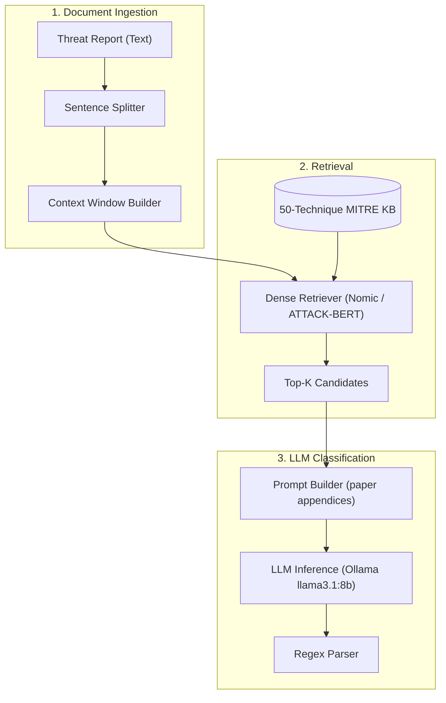

# ThreatMap: Reproduction Study of RAG-ATT&CK (Schuurman, 2025)

[](LICENSE)
[](https://www.python.org/)
[](scripts/run_retrieval_table3.py)

---

## 1. What This Is

ThreatMap is a reproduction study of:

> Stijn Schuurman. *RAG-ATT&CK: Exploring RAG-Assisted Mapping of Cyber Threat Intelligence to MITRE ATT&CK Techniques*, Master's Thesis, University of Twente, 2025.

The paper describes a Retrieval-Augmented Generation (RAG) pipeline that maps sentences from Cyber Threat Intelligence (CTI) reports to [MITRE ATT&CK®](https://attack.mitre.org/) techniques. This repository reproduces the retrieval (Table 3) and LLM classification (Table 2) experiments from that paper.

**Hardware used for this reproduction**: Intel i5-12450H, 16 GB RAM, no GPU. LLM runs use Ollama with `llama3.1:8b-instruct-q4_0`. 70B and DeepSeek-R1 runs are **not reproduced** (hardware limitation).

→ Full reproduction report: [`artifacts/reproduction_report.md`](artifacts/reproduction_report.md)

---

## 2. Dataset

The paper and this reproduction use **TRAM v1.3** by the Center for Threat-Informed Defense (CTID):

| Metric | Value |
| :--- | ---: |
| Total sentences | **19,178** |
| Sentences with in-scope labels | **4,070** |
| Total label instances (50 classes) | **5,143** |
| CTI reports | 151 |
| Target technique classes | 50 |

Dataset pinned at commit `f29793d8d665f7f552898696e00065ef24a29a20`.

> [!NOTE]
> The paper evaluated on all 19,178 sentences (not just the 4,070 labelled ones). Unlabelled sentences appear as negative examples and inflate the false-positive denominator, which explains the low precision numbers in Table 2.

---

## 3. Research Foundation

* **Primary Reference**: *RAG-ATT&CK* (Schuurman, 2025) — describes using local Llama and DeepSeek models with nomic and ATTACK-BERT embeddings for technique mapping.
* **Dataset**: TRAM v1.3 (CTID) — **19,178 sentences** across 151 CTI reports, **50 technique classes**, **5,143 label instances**.
* **Retrieval models**: `nomic-ai/nomic-embed-text-v1.5`, `basel/ATTACK-BERT`
* **Reranker**: `cross-encoder/ms-marco-MiniLM-L-6-v2`
* **LLM**: Ollama `llama3.1:8b-instruct-q4_0` (8B only; 70B/R1 not run)

---

## 4. Reproduction Results

### Table 3: Retrieval Recall@k

Evaluated over all 4,070 labelled sentences with fixed denominator = 5,143.
Primary nomic prefix: `search_query:` for sentences, `search_document:` for descriptions.

| Configuration | Paper R@10 | Reproduced R@10 | Delta |
| :--- | ---: | ---: | ---: |
| Nomic Full (with prefixes — PRIMARY) | 80.28% | 80.52% | +0.24% |
| Nomic Full (no prefixes — variant) | 80.28% | 81.16% | +0.88% |
| Nomic First Paragraph (with pfx) | 77.06% | 69.45% | −7.61% |
| Nomic Chunks 750/80 (with pfx) | 77.61% | 74.92% | −2.69% |
| Nomic Chunks 375/50 (with pfx) | 71.70% | 71.86% | +0.16% |
| ATTACK-BERT Full | 86.05% | 81.84% | −4.21% |
| ms-marco Reranker (Top 15) | 74.59% | 80.75% | +6.16% |

See [`artifacts/retrieval_table3_real_results.json`](artifacts/retrieval_table3_real_results.json) for full R@1/5/10/20 breakdown.

**Deviations**:
- **ATTACK-BERT** (−4.21%): Cause not identified. Untested hypotheses: text cleaning, pooling strategy.
- **Reranker** (+6.16% vs paper −5.69% vs nomic): Qualitative reversal — in our run the reranker *improves* over nomic, while the paper shows it *hurts*. Cause not identified.

### Table 2: LLM Classification (8B only, ~191-sentence sample)

> [!WARNING]
> The LLM scorer ran on a **~191-sentence sample** (2 CTI reports), not the paper's 19,178 sentences. These metrics are directional only — compare trend, not values.

| Exp | Name | Micro F1 (sample) | Paper Micro F1 | Paper Macro F1 | Status |
| --- | :--- | ---: | ---: | ---: | :--- |
| #19 | BaseLLM 8B (no RAG) | 4.00% (pilot) | 4.77% | 4.27% | DIRECTIONAL |
| #22 | BaseRAG 8B (nomic, k=10) | 30.00% (pilot) | 18.81% | 19.47% | DIRECTIONAL (tiny sample) |
| #25 | Optimized RAG 8B (ATTACK-BERT, k=10) | 40.00% (pilot) | 15.40% | 16.84% | DIRECTIONAL (tiny sample) |
| #27 | Context 1-sentence (nomic, k=10) | 37.50% (pilot) | 13.58% | 15.60% | DIRECTIONAL (tiny sample) |
| #23 | Full Desc 8B | — | — | 6.76% | NOT RUN (time) |
| #24 | Optimized RAG full desc 8B | — | — | — | NOT RUN (time) |
| #26 | Context 2-sentences 8B | — | — | — | NOT RUN (time) |
| #28 | Few-shot 8B | — | — | — | NOT RUN (time) |
| #29 | BaseRAG 70B | — | — | — | NOT RUN (no GPU) |
| #30 | BaseRAG DeepSeek-R1 70B | — | — | — | NOT RUN (no GPU) |
| #36 | Optimized RAG DeepSeek-R1 70B | — | — | — | NOT RUN (no GPU) |

The pilot scores use only 20 sentences (3 gold labels, 2 classes with support) — the CI is very wide and the numbers are not reliable.

### Extension: BM25 + RRF Fusion (not in paper)

| Method | R@1 | R@5 | R@10 | R@20 |
| :--- | ---: | ---: | ---: | ---: |
| Paper: Nomic Full (target) | — | — | 80.28% | — |
| Nomic w/ prefixes (reproduced) | 35.82% | 68.60% | 80.52% | 90.43% |
| BM25 alone | 23.20% | 49.83% | 64.38% | 80.07% |
| BM25 + Nomic RRF k=60 | 32.94% | 65.14% | 78.55% | 89.99% |

RRF fusion *hurts* vs nomic alone (78.55% < 80.52%). BM25 alone is substantially weaker. This is an extension result not in the paper.

---

## 5. System Architecture



---

## 6. Technology Stack

* **Language**: Python 3.10+
* **Embeddings**: `sentence-transformers` (`nomic-embed-text-v1.5`, `ATTACK-BERT`)
* **Reranker**: `cross-encoder/ms-marco-MiniLM-L-6-v2`
* **LLM**: Ollama (`llama3.1:8b-instruct-q4_0`)
* **Lexical**: `rank-bm25` (BM25 Okapi — used in extension, not paper)
* **Vector Index**: NumPy dot-product (normalized cosine)
* **Testing**: pytest

---

## 7. Quickstart

```powershell
# Clone and install
git clone https://github.com/your-username/ThreatMap.git
cd ThreatMap
pip install -e .

# Run tests
python -m pytest tests/ -v

# Reproduce Table 3 retrieval (uses pre-computed embeddings)
python scripts/run_retrieval_table3.py

# Score LLM sample (requires Ollama with llama3.1:8b-instruct-q4_0)
python scripts/run_llm_sample.py --mode sample --experiments 19 22 25 27
python scripts/score_llm_sample.py --mode sample

# Run BM25+RRF extension
python scripts/run_bm25_rrf.py

# Generate figures (Fig 2 & 4)
python scripts/generate_figures.py

# Generate full reproduction report
python scripts/generate_reproduction_report.py
```

---

## 8. Integrity Rules

1. **No simulated results**: All numbers come from real embedding computations or real Ollama calls cached to disk.
2. **No targets changed to fit results**: Paper targets in `scripts/` are sacred.
3. **Speculation labelled**: Deviations not yet tested are marked "untested hypothesis".
4. **No 70B/R1 results**: Hardware does not permit these; they are marked NOT RUN.
5. **Bootstrap CI**: The only randomness in the scorer (seed=42, 1000 resamples, documented).

---

## 9. What the Paper Found (Not Reproduced at Full Scale)

The paper (Schuurman 2025) found:
- **ATTACK-BERT**: R@10 = 86.05% (best retrieval model)
- **BaseRAG 8B**: Micro F1 = 18.81% / Macro F1 = 19.47% (best 8B LLM result)
- **DeepSeek-R1 70B**: Macro F1 ≈ 23.17% stripped (best overall)
- **Reranker hurts**: Adding a cross-encoder reranker degraded recall vs dense-only
- **The paper did NOT compare against BM25 or lexical-only retrieval**

---

## 10. References

* Schuurman, S. (2025). *RAG-ATT&CK: Exploring RAG-Assisted Mapping of Cyber Threat Intelligence to MITRE ATT&CK Techniques*. Master's Thesis, University of Twente.
* CTID. *TRAM v1.3*. [github.com/center-for-threat-informed-defense/tram](https://github.com/center-for-threat-informed-defense/tram) (commit `f29793d8`)
* MITRE ATT&CK® Enterprise v16.0 (October 2024). [attack.mitre.org](https://attack.mitre.org/)

---

## 11. License

MIT License — see [LICENSE](LICENSE).
