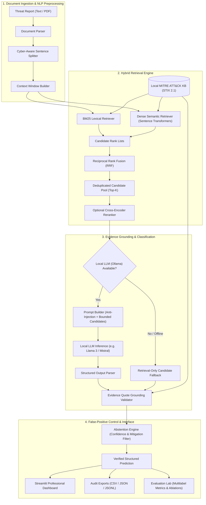

# ThreatMap System Architecture

## Architectural Overview

ThreatMap is an on-premise, offline-capable NLP system designed to ingest unstructured cybersecurity threat intelligence reports and map extracted adversary behaviors to structured **MITRE ATT&CK** enterprise techniques.

## Architectural Layers

### 1. Ingestion & Preprocessing
* **Document Parser**: Ingests pasted raw text, `.txt` files, and `.pdf` threat bulletins with 10MB input sanitization.
* **Cybersecurity-Aware Sentence Splitter**: Protects technical identifiers with periods (`powershell.exe`, `192.168.1.5`, `T1059.001`, `CVE-2023-38831`, `https://...`) from inadvertent sentence truncation.
* **Context Window Builder**: Associates each target sentence with its predecessor ($S_{i-1}$) and successor ($S_{i+1}$) to retain narrative context.

### 2. Hybrid Retrieval Engine
* **Lexical Retrieval (BM25 Okapi)**: Indexes exact command-line syntax, binary names, and ATT&CK IDs.
* **Semantic Retrieval**: Generates 384-dimensional dense vectors using `sentence-transformers/all-MiniLM-L6-v2`. Computes exact dot-product cosine similarity over unit-normalized embeddings.
* **Reciprocal Rank Fusion (RRF)**:
  $$\text{RRF}(d) = \sum_{m \in M} \frac{1}{k + \text{rank}_m(d)}$$
  Fuses lexical and semantic rankings with parameter $k=60$.
* **Optional Reranker**: Employs a cross-encoder model to score query-candidate pairs directly.

### 3. Classification & Evidence Grounding
* **Strict Candidate Bounding**: The local LLM is restricted to classifying only among retrieved candidates.
* **Anti-Prompt-Injection Architecture**: System prompts instruct the LLM to treat all input report content as untrusted observational evidence, neutralising embedded instructions.
* **Evidence Quote Verification**: Predictions require verbatim textual evidence quotes present in the report.

### 4. False-Positive Control & Abstention
* **Abstention Engine**: Suppresses predictions when similarity falls below calibrated thresholds or when sentences represent non-adversarial text (mitigation advice, disclaimers).
